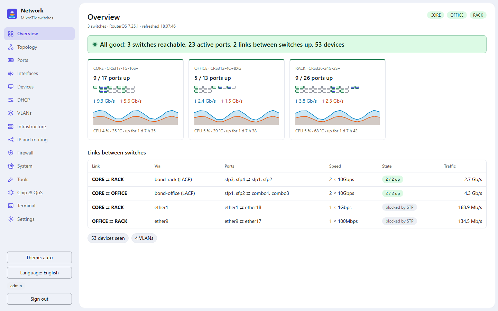
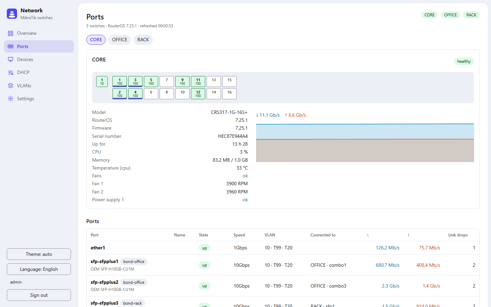
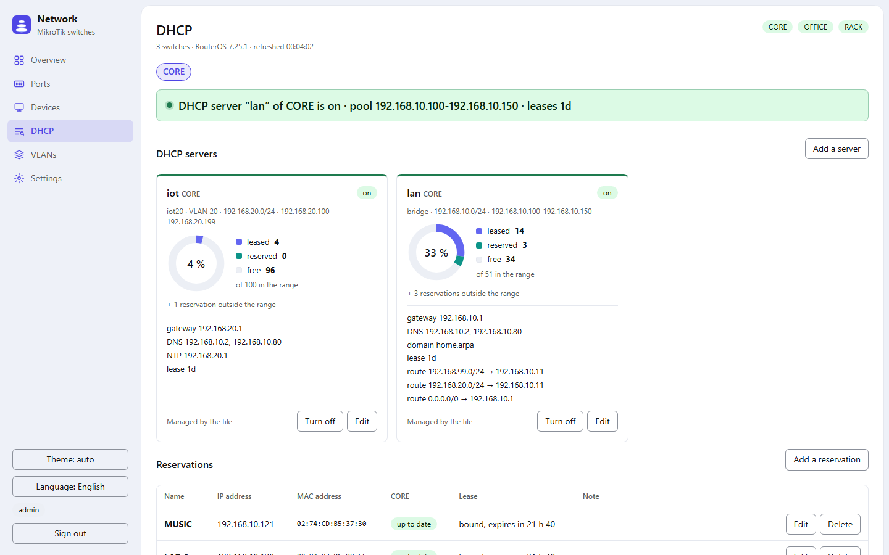
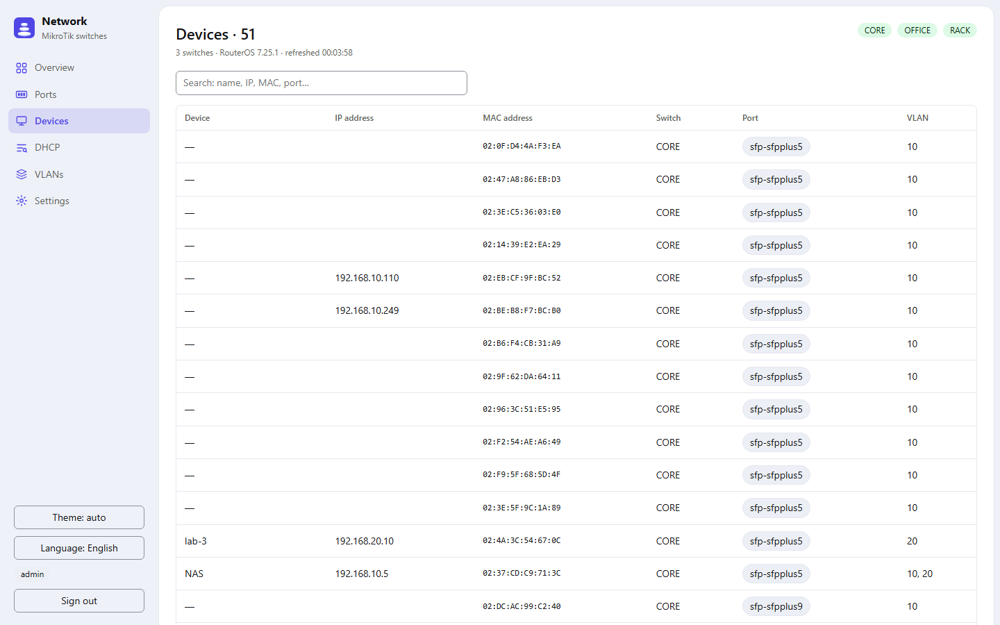
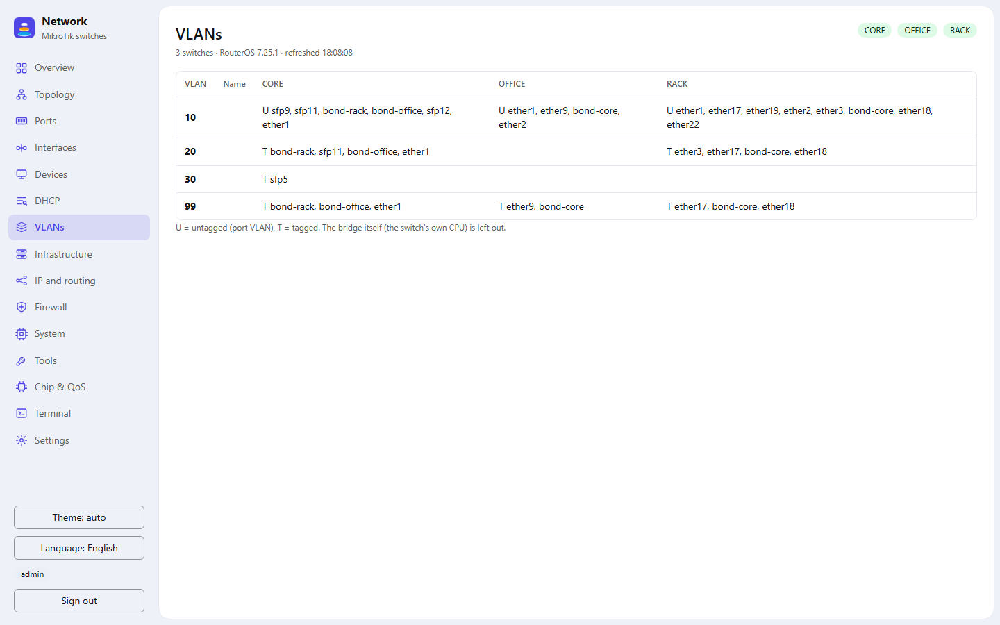
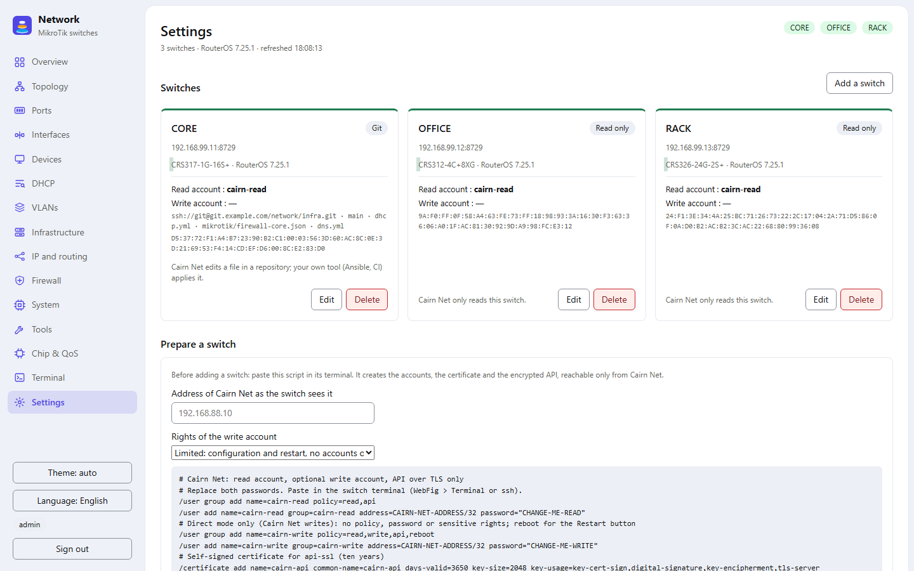

<p align="center"></p>

# Cairn Net (`cairn-net`)

A web panel for a few **MikroTik RouterOS** switches and routers: what is
plugged where, link state and traffic, VLANs, and the DHCP servers and
reservations of the router. One Rust binary with the page embedded, in a
small Docker image. It talks to the switches through the RouterOS API over
TLS (`api-ssl`), with a read-only account by default.

> Interface in English and French. Early days: it runs every day on its
> author's network (three CRS switches), on RouterOS 7. Issues and pull
> requests are welcome. Sister project:
> [Cairn](https://github.com/JBelliriGenty/Cairn-NAS), the same panel for a
> Debian + ZFS NAS.

<picture><source media="(prefers-color-scheme: dark)" srcset="docs/screenshots/overview-dark.png"></picture>

<table>
<tr><td><picture><source media="(prefers-color-scheme: dark)" srcset="docs/screenshots/ports-dark.png"></picture></td><td><picture><source media="(prefers-color-scheme: dark)" srcset="docs/screenshots/dhcp-dark.png"></picture></td></tr>
<tr><td align="center">Ports</td><td align="center">DHCP</td></tr>
<tr><td><picture><source media="(prefers-color-scheme: dark)" srcset="docs/screenshots/clients-dark.png"></picture></td><td><picture><source media="(prefers-color-scheme: dark)" srcset="docs/screenshots/vlans-dark.png"></picture></td></tr>
<tr><td align="center">Devices</td><td align="center">VLANs</td></tr>
<tr><td><picture><source media="(prefers-color-scheme: dark)" srcset="docs/screenshots/settings-dark.png"></picture></td><td></td></tr>
<tr><td align="center">Settings</td><td></td></tr>
</table>

Screenshots follow your GitHub theme (light or dark); the panel has both.
Demo data.

## What it does

- **Overview**: every switch at a glance (ports up, traffic, CPU,
  temperature, uptime, health sensors) and the links between switches.
- **Ports**: front panel per switch, speed, traffic, what is behind each
  port.
- **Devices**: every MAC address the switches see, with its port, VLAN, IP
  address and name (DHCP leases, ARP, reverse DNS).
- **VLANs**: which ports carry which VLAN, tagged or untagged.
- **DHCP**: servers (pool use, options, static routes) and reservations of
  the router, with an editor that shows the difference before anything is
  written. Servers can be added, renamed and deleted, take any DHCP option
  (code and value), and can watch their interface for another DHCP server.
  The names of the leases can be published to a DNS server (below), and in
  Git mode a file of static DNS names is edited there too.
- **Infrastructure**: one page per switch, like WebFig's Quick Set:
  identity, addresses per interface or VLAN, default gateway, DNS, bridges
  and their ports, NAT rules, RouterOS and firmware versions, available
  update, uptime. In direct mode, the identity, DNS servers, one address
  and the gateway can be changed, each change guarded by an automatic
  rollback (below).
- **Firewall**: filter, NAT, mangle and raw rules in order with their
  counters, address lists, interface lists, connection tracking. In direct
  or Git mode, one table at a time is edited (by hand or from templates:
  isolated network, block or allow between networks, masquerade, port
  forward), previewed as API commands, then applied with an automatic
  rollback of the whole table. A change that could drop, redirect or
  re-route Cairn Net's own connection to the switch is refused.
- **Settings**: switches are added from the page. Cairn Net reads the
  certificate of the switch first, you compare its fingerprint, then the
  accounts are tried. A RouterOS script to prepare a switch is shown there.

## How each switch is managed

Per switch, in Settings:

| Mode | What Cairn Net does |
|---|---|
| **Read only** (default) | Reads. Nothing is ever written. |
| **Direct** | Writes the DHCP servers and reservations, and the Infrastructure settings, to the switch through its API, with a second account that can write. It reads the switch back afterwards and says whether it matches. |
| **Git** | Edits a DHCP file in a Git repository and pushes one commit per change, under the name of the person who applies it. Your own tool (Ansible, CI…) applies the file to the switch. The firewall file, if set, is applied by Cairn Net itself (write account), then committed once the change is kept. |

Direct mode suits a router managed by hand; Git mode suits one managed as
code. Both use the same editor and checks: reservations inside the network,
no duplicate MAC, IP or name, ranges and gateways that make sense.

## Install

With Docker, on any machine that can reach the switches' `api-ssl` port
(8729):

```sh
mkdir -p cairn-net/config cairn-net/data && cd cairn-net
curl -fsSLO https://raw.githubusercontent.com/JBelliriGenty/Cairn-Net/main/examples/compose.yml
curl -fsSL https://raw.githubusercontent.com/JBelliriGenty/Cairn-Net/main/examples/config.json -o config/config.json

# HTTPS certificate (or use your own)
openssl req -x509 -newkey rsa:2048 -nodes -days 3650 -subj /CN=cairn-net \
  -keyout config/key.pem -out config/cert.pem

# a user: the password is read on stdin
printf 'admin:' > config/users
docker run --rm -i ghcr.io/jbellirigenty/cairn-net hash-password >> config/users

# the container runs as nobody (65534)
chown -R 65534:65534 config data && chmod 600 config/key.pem config/users

docker compose up -d
```

Then open `https://<address>:8443`, sign in, and add your switches in
**Settings**.

The data directory keeps the switches and their accounts
(`settings.json`, readable by the container only), the Git deploy key and
the clones of the repositories.

### Preparing a switch

Settings shows a script to paste in the switch terminal (WebFig → Terminal,
or SSH), filled with the address of Cairn Net. It creates:

1. a **read** account (`read,api`);
2. optionally a **write** account for direct mode (`read,write,api`, without
   `policy`, `password`, `reboot` or `sensitive`);
3. a self-signed certificate for `api-ssl`, with the service limited to the
   address of Cairn Net;

then prints the certificate fingerprint, to compare with the one Cairn Net
shows when you add the switch. A different fingerprint later (certificate
regenerated, or someone in the middle) means the connection is refused
before any password is sent.

## Sign-in

Two ways, set in `config.json`:

- **Built-in** (`login` + `tls`): users from the users file, one
  `name:hash` line each, hashes made by `hash-password` (PBKDF2-SHA256). The
  file is read at each sign-in: no restart needed after editing it. Session
  cookie, expired after `session_minutes` of inactivity; failed attempts
  double the wait for that address. HTTPS is required.
- **Behind an authenticating reverse proxy** (Authelia, Authentik, oauth2-proxy…):
  no `login`; Cairn Net only answers requests from `trusted_proxies` that
  carry the user in `user_header` (default `Remote-User`) and, if
  `require_groups` is set, one of those groups in `groups_header` (default
  `Remote-Groups`). Commits are then signed with `Remote-Name` and
  `Remote-Email` when the proxy sends them. See `examples/config-proxy.json`.

## Configuration

`config.json`:

| Key | Default | |
|---|---|---|
| `listen` | `127.0.0.1:9093` | address and port |
| `title`, `subtitle` | | shown in the page |
| `lang` | `en` | default language of the page (`en`, `fr`); each viewer can switch |
| `data_dir` | `/var/lib/cairn-net` | |
| `login` | | `{"users_file": "/etc/cairn-net/users", "session_minutes": 30}` |
| `tls` | | `{"cert": "…/cert.pem", "key": "…/key.pem"}`, PEM files |
| `trusted_proxies`, `user_header`, `groups_header`, `require_groups` | | proxy mode |
| `switches` | | seeds Settings the first time only (`name`, `host`, `sha256`, `user`, `mode`…); then Settings is the reference |
| `notify` | | `{"url": "https://ntfy.example.com/topic", "headers_file": "…"}`: alerts (firewall differing from its Git file) are POSTed there; the file holds header lines (`Authorization: Bearer …`) |

## Git mode

Cairn Net creates one SSH deploy key at first start and shows its public
half in Settings. Add it to the repository **with write access**, then set,
for the switch: the repository (`ssh://…`), the branch and the path of the
DHCP file. On each change, Cairn Net starts from the tip of the branch,
replays the changes, refuses if a check fails, commits and pushes. A commit
pushed by someone else in between is kept.

The DHCP file is YAML, edited as text: comments and layout outside the
touched entry stay as they are.

The firewall file (optional, its own path) is JSON, one key per table and
one rule per line, in RouterOS properties; a table missing from it is not
managed:

```json
{
  "filter": [
    {"action":"accept","chain":"input","connection-state":"established,related"},
    {"action":"drop","chain":"forward","comment":"IoT: no LAN","dst-address":"192.168.10.0/24","in-interface":"vlan20"}
  ],
  "nat": []
}
```

The Firewall page shows whether the switch runs the file as written. Edits
start from the file, are applied with the rollback, and are committed when
you keep them. "Apply the file" puts a table back as the file says;
"Import the switch's rules into the file" commits what the switch runs (a
good first step). Every 10 minutes Cairn Net compares them and sends an
alert (`notify`) when that changes.

```yaml
dhcp_reservations:
  # comment lines above an entry belong to it
  - "AA:BB:CC:DD:EE:01,192.168.10.20,printer"
  - "AA:BB:CC:DD:EE:02,192.168.10.21,nas"

dhcp_servers:
  - name: lan
    enabled: true
    interface: bridge
    network: 192.168.10.0/24
    range: 192.168.10.100-192.168.10.199
    gateway: 192.168.10.1
    dns: [192.168.10.2]
    domain: home.arpa
    ntp: []
    lease_time: 1d
    routes:
      - "192.168.20.0/24,192.168.10.254"
    options:                        # any other option, RouterOS syntax
      - "66,'tftp.home.arpa'"
    alert: true                     # watch for another DHCP server
    alert_valid: [AA:BB:CC:DD:EE:09]  # other servers that are expected
```

Applying it is up to you: for example an Ansible play that turns each
reservation into a static lease and each server into
`/ip dhcp-server`, `/ip pool` and `/ip dhcp-server network` (routes as
option 121).

The static DNS names file (optional, its own path) is YAML too: one list
of `"IP name"` strings, as a hosts file or a DNS server's local records take
them. The DHCP page edits it (name, IP, comment) with the same preview and
commit; your own tool publishes it to the DNS servers. Checks: valid IP,
valid name (labels separated by dots), no entry listed twice, no name
already taken by a DHCP reservation or by the name of a lease. When the
switch publishes its lease names with the `hosts` integration (below), each
name is also asked to those DNS servers (plain DNS queries, no account) and
shown as served, missing or answering another address.

```yaml
local_names:
  # router and NAS
  - "192.168.10.1 router"
  - "192.168.10.5 nas"
  - "192.168.10.5 files.example.org"
```

## Another DHCP server on the network

With `alert` on, the switch probes the server's interface with a DHCP
discover every minute (RouterOS `/ip dhcp-server alert`). A server that
answers and is not in `alert_valid` shows on the server card, with its MAC
address, for an hour after it was last seen. Useful before switching DHCP
from one box to another, and to catch a forgotten home router.

## Names of the leases in DNS

Per switch, in Settings: publish the names of the bound leases (device name
in lower case, letters, digits and dashes), of all DHCP servers or some of
them, every 2 minutes. A switch that cannot be read sends nothing: the
previous names stay.

- **Static DNS of the switch** (write account): entries in `/ip dns static`
  commented `cairn-net`, named `name.domain` when the DHCP network has a
  domain. Other entries are never touched.
- **Hosts file over SSH** (Pi-hole, dnsmasq `hostsdir`): Cairn Net sends
  `IP name` lines with its own SSH key (the one shown for Git) to each
  `user@host[:port]`. On the DNS server, copy `examples/cairn-net-hosts` to
  `/usr/local/bin` (mode 755) and force it in `authorized_keys`, so that the
  key can do nothing else:

  ```
  command="/usr/local/bin/cairn-net-hosts /etc/pihole/hosts/cairn-net.list /etc/pihole/hosts/custom.list",restrict ssh-ed25519 AAAA… cairn-net
  ```

  The first path is the file it writes; the next ones hold names it must
  not publish again (compared without their domain). Settings shows this
  line with your key.

## Infrastructure changes and their rollback

Changing an address or a gateway can cut the switch off. So, in direct
mode, before the first command Cairn Net adds a RouterOS scheduler
(`cairn-net-rollback`) holding the old values. Then it runs the commands,
reads the switch back through a new connection and starts a 60 s
countdown. **Keep** (a new connection again) removes the scheduler; without
it, the switch puts the old settings back by itself and logs
`cairn-net: change not confirmed, rolled back`. The preview shows both the
commands and the rollback script.

The interface Cairn Net reaches the switch through is never offered, and a
new address may not overlap the network of the switch's management address
or of Cairn Net's own address. Reset, password, VPN, router/bridge mode,
NAT, reboot and upgrade are not done from here.

The read account may not run `check-for-updates`: the page compares the
installed RouterOS with the version MikroTik publishes for the switch's
channel (`https://upgrade.mikrotik.com/routeros/NEWESTa7.<channel>`, fetched
by Cairn Net at most every 6 hours).

## Security notes

- Read-only accounts by default; the write account has no `policy`,
  `password`, `reboot` or `sensitive` rights.
- The switch certificate is pinned (SHA-256 fingerprint).
- Passwords of the switch accounts are kept in `data/settings.json`
  (mode 600, owner of the container), never sent back to the page.
- Every write is shown first as a difference; direct mode reads the switch
  back after writing, and Infrastructure changes roll back by themselves
  unless confirmed.
- No third-party JavaScript, a strict Content-Security-Policy, POSTs in
  JSON only.

## Build

```sh
docker build -t cairn-net .
```

The build runs the tests (`cargo test`). Without Docker: Rust 1.85 or
later, `libssl-dev`, `cargo build --release --locked`; at run time `git`
and `ssh` for Git mode, `curl` for alerts.

## License

MIT
